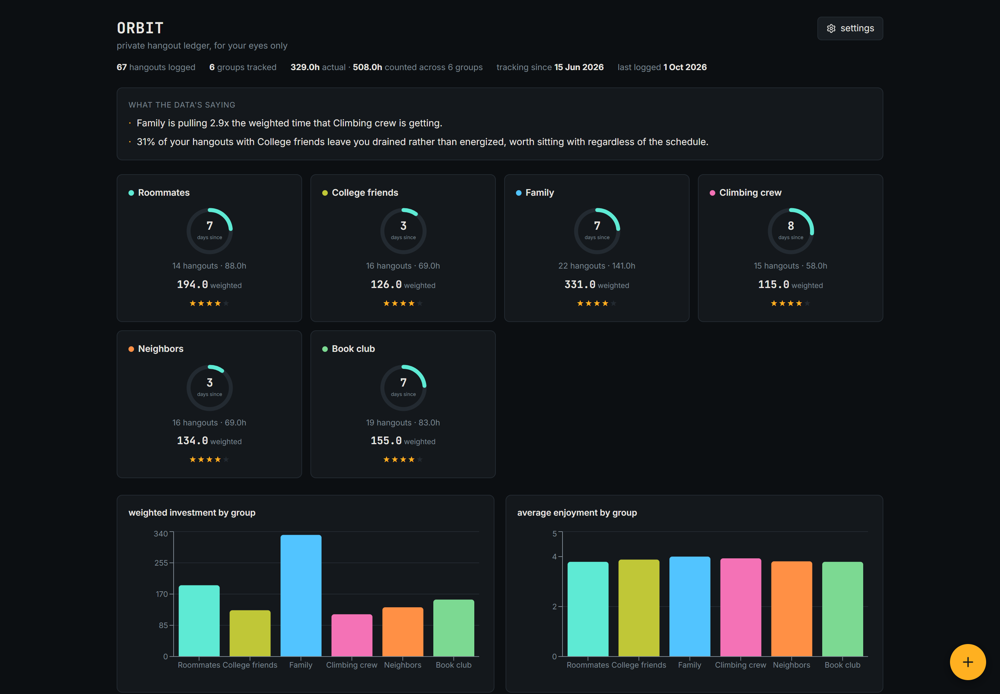
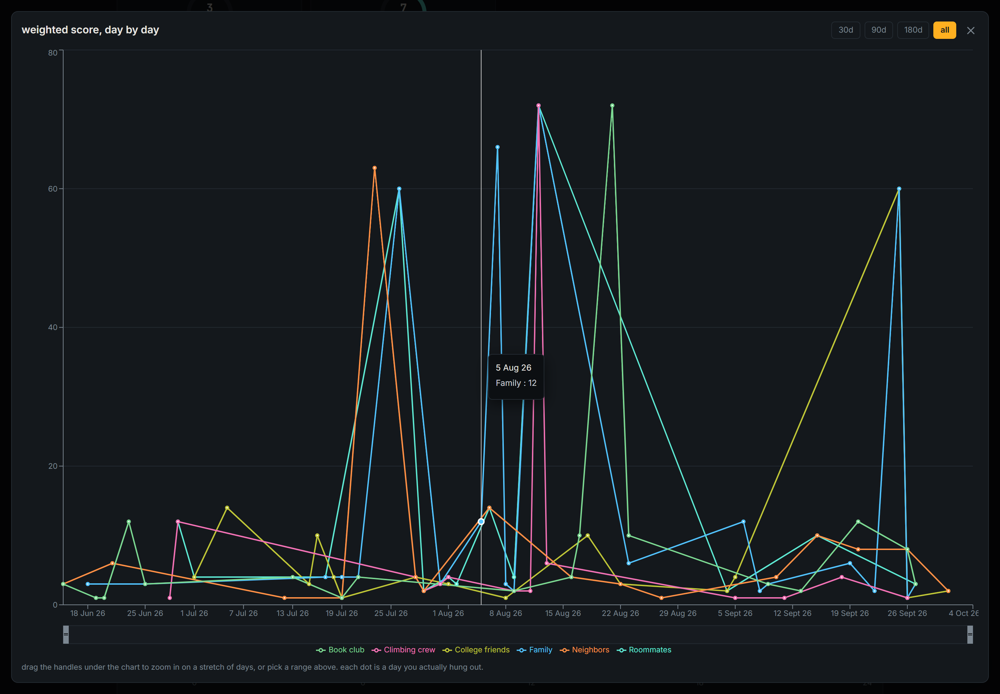
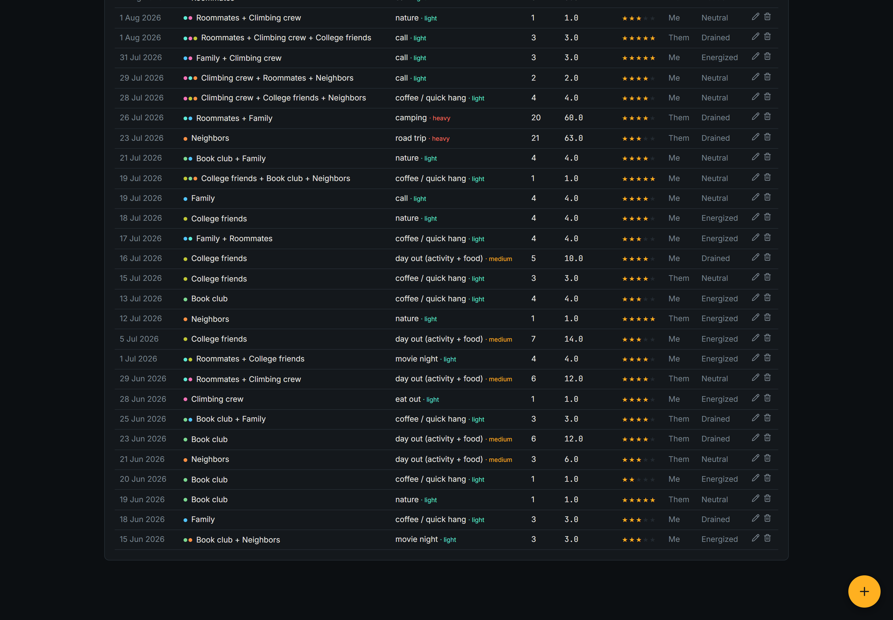
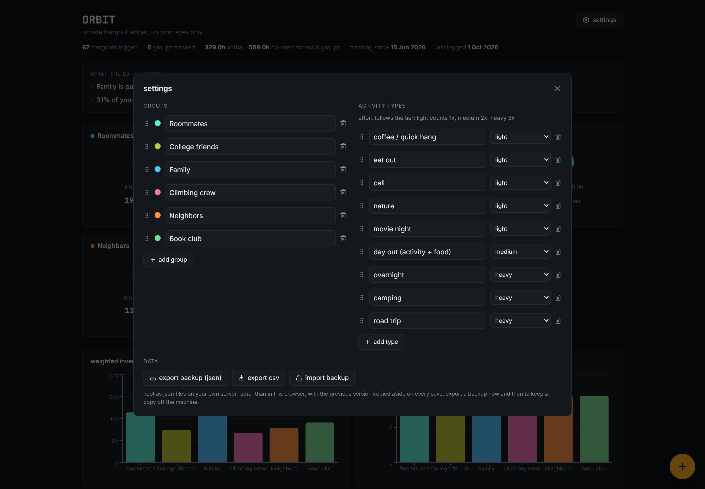
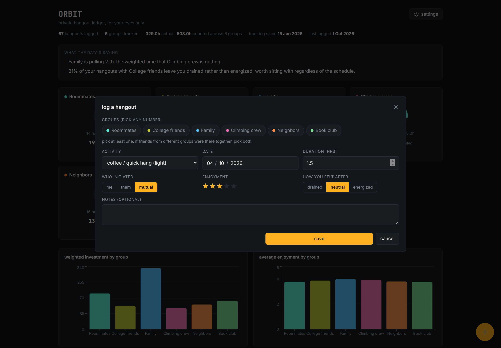
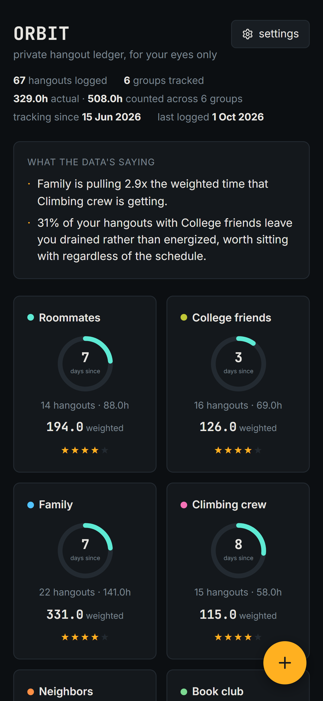

# Orbit

**A private hangout ledger.** Log who you saw, for how long, doing what, who initiated, and how you felt afterwards. Then look at the numbers.

Not a social app and not a habit tracker. It answers a question most people never ask out loud: *where is my time actually going, and which of it leaves me better off?*

<br/>



<details>
<summary>More screenshots</summary>

<br/>

**Fullscreen trend view.** One point per day across all history, with drag-to-zoom.



**Charts.** Weighted investment and average enjoyment, per group.



**Settings.** Groups, activity types, colours, drag-to-reorder.



**Logging a hangout.**



**On a phone.**



</details>

---

## How it works

- **Weighted time, not hours.** Every activity type carries a tier: light counts 1x, medium 2x, heavy 3x. Three hours of coffee and three hours of camping are not the same investment, and the app should not pretend they are.
- **Groups, not people.** You track circles (family, roommates, a climbing crew) rather than individuals, so the data stays about your habits instead of becoming a contact list.
- **It reads back to you.** The top of the page states what the numbers show in plain language, including when the answer is uncomfortable.
- **Your data is a file.** A single `entries.json` on disk that you own, readable and diffable, not a row in someone else's database.

## Stack

| Layer | |
|---|---|
| Front end | React 19, Vite 8, Recharts 3, Tailwind 4, lucide-react |
| Back end | Node.js ESM, `node:http`, zero dependencies |
| Storage | Plain JSON files with atomic writes and rotating backups |
| Hosting | Ubuntu Server, systemd, Cloudflare Tunnel + Access |

## Running it locally

```bash
pnpm install

# generate fictional sample data so you have something to look at
node scripts/seed-demo.mjs

# point the server at it and start both halves
ORBIT_DATA=./demo pnpm dev
```

On Windows PowerShell:

```powershell
$env:ORBIT_DATA="./demo"; pnpm dev
```

Then open http://localhost:5173.

Without `ORBIT_DATA` the server writes to `/var/lib/orbit` and the app starts empty. That is deliberate: there is no silent fallback to browser storage, because a silent fallback is how a broken persistence layer ships unnoticed.

## The parts worth reading

The interesting engineering here is not the UI. It is the storage layer and the deployment.

### A JSON store that cannot eat your data

`server/server.mjs` is a single file with no dependencies. It serves the built app and a small key/value API, and it writes to disk like this:

- **Atomic writes.** Every save writes to a temp file and then renames it over the target. A crash mid-write cannot leave a half-written file.
- **Rotating backups.** The last 20 versions of each key are kept.
- **A 5MB body cap** and a directory-containment check on every path, so a crafted request cannot write outside the data directory.

The failure mode this was built to prevent: under the old browser-storage version, a failed read silently fell back to defaults. Moving to a server turned that into a data-loss machine, because a transient read failure would boot the app empty and the next save would write a one-entry array over everything.

The fix is a persistent load-error banner plus write guards. It was verified by killing the API mid-session and confirming the file on disk was **byte-identical by md5** and the UI refused to save.

### Sandboxed systemd service

```ini
User=orbit
NoNewPrivileges=true
PrivateTmp=true
ProtectSystem=strict
ProtectHome=true
ReadWritePaths=/var/lib/orbit
```

`ProtectSystem=strict` mounts the whole filesystem read-only for this service. `ReadWritePaths` is the only hole, and it points at the data directory. Code and data are split (`/opt/orbit` and `/var/lib/orbit`) so a deploy cannot delete your data.

### Measured, not guessed

- Dragging the trend chart's brush rebuilt five charts and the full table on every frame. Moving zoom state into its own component took the worst frame from **1,554ms to 458ms**, and button response from **361ms to 43ms**, measured with an identical harness before and after.
- The group palette was validated for colour-vision separation rather than eyeballed: ten colours checked against a contrast floor, picked by a max-min search over 219 candidates. The scrollbar, which measured 1.32:1 against its track, was fixed to 5.25:1.

## Deploying

See [`server/DEPLOY.md`](server/DEPLOY.md) for the full runbook (Ubuntu, systemd, Cloudflare Tunnel, backups). A sample unit file is at [`server/orbit.service`](server/orbit.service).

The short version: the service binds to loopback only, and Cloudflare Tunnel is what puts it on the internet. Nothing listens on a public interface.

## License

MIT
